<p align="center">
  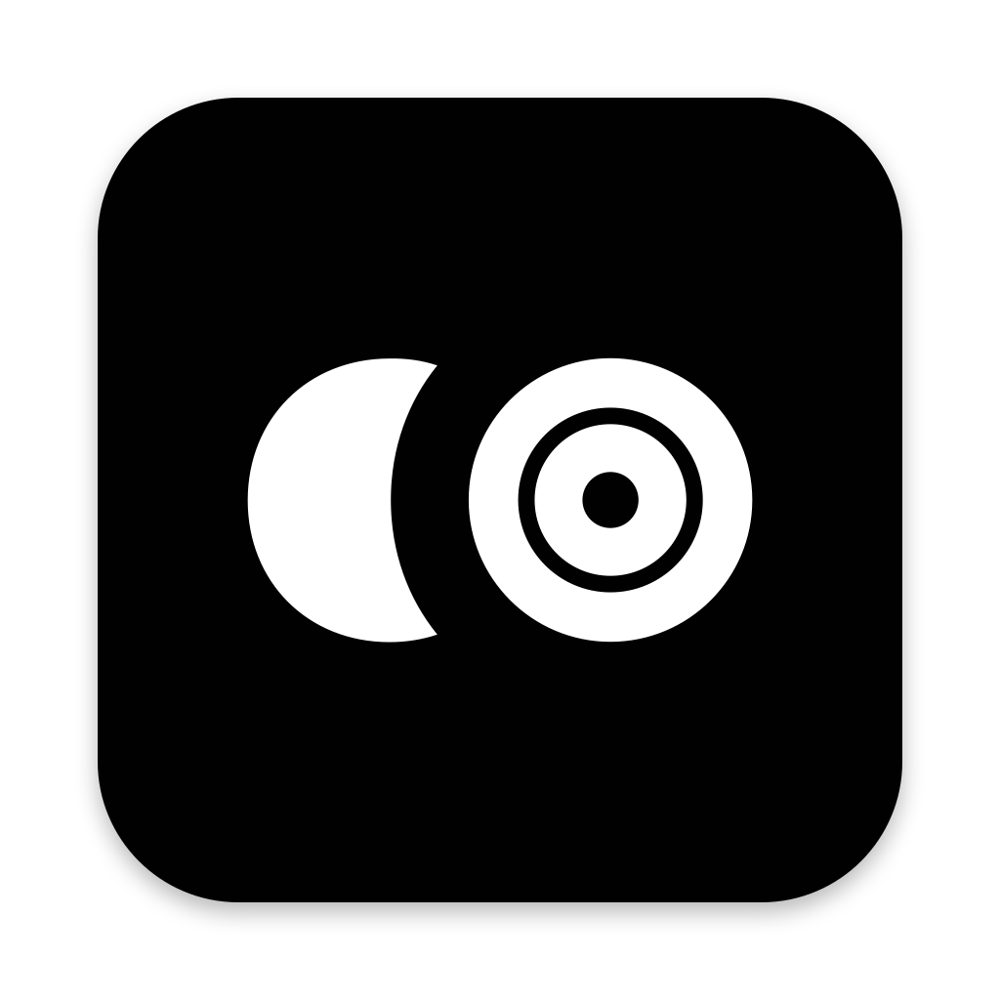
</p>

<h1 align="center">UzDisc</h1>

<p align="center">
  <b>Diskini aç. Dosyalarını kurtar.</b><br>
  Mac'in açamadığı ya da Finder'da hiç görünmeyen diskleri <b>salt okunur</b> olarak tarar,<br>
  dosyalarını güvenle Mac'ine kopyalar. Ücretsiz, sınırsız, açık kaynak.
</p>

<p align="center">
  <a href="../../releases/latest"></a>
  
  
  
  
</p>

<p align="center">
  <a href="#english">English ↓</a>
</p>

<p align="center">
  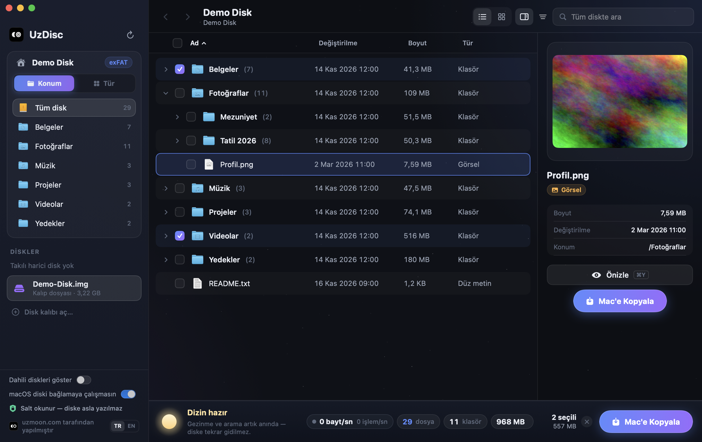
</p>

---

## Neden UzDisc?

Harici diskini taktın ama Mac görmüyor. Disk İzlencesi'nde var ama "bağlanamıyor", Finder'da yok.
Ya da her takışta dakikalarca "kontrol ediliyor" ve sonunda hiç açılmıyor. Veri kurtarma uygulamaları ise
dosyalarını gösterip **"kaydetmek için satın al"** diyor.

UzDisc bu durum için yazıldı:

- 🔒 **Asla yazmaz.** Disk yalnızca `O_RDONLY` ile açılır. Silme, onarma, biçimlendirme yok. Kodda kaynak diske yazan tek bir satır yok.
- ⚡ **Bağlanmayı beklemez.** macOS diski bağlayamasa bile dosya sistemi doğrudan diskten okunur (exFAT, FAT32/16/12, NTFS).
- 🌙 **macOS'tan önce okur.** UzDisc açıkken macOS'un diski otomatik bağlamaya çalışmasını engelleyebilir; yavaş bir bağlantıyı macOS'un disk kontrolü meşgul etmez.
- 🗂 **Konum ya da türe göre gez.** Tüm disk bir kez taranır; sonra gezinme ve **tüm diskte arama** anında olur. Fotoğraf, video, belge, ses, arşiv… her türün dosya sayısı ve boyutu.
- 👁 **Ne olduğunu gör.** Fotoğraf, video ve PDF küçük resimleri, Quick Look ile tam önizleme (⌘Y).
- ⚡ **Önce bunu tara.** İstediğin klasöre öncelik ver; tarama oraya atlar. Duraklat / sürdür.
- 📈 **Neler olduğunu gör.** Canlı okuma hızı (MB/sn · işlem/sn), disk donarsa açık uyarı, yavaş USB 2.0 kablo tespiti.
- 🆓 **Tamamen ücretsiz.** Sınır yok, abonelik yok, reklam yok.

<table>
  <tr>
    <td>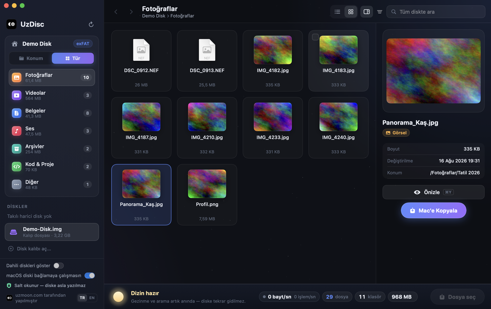</td>
    <td>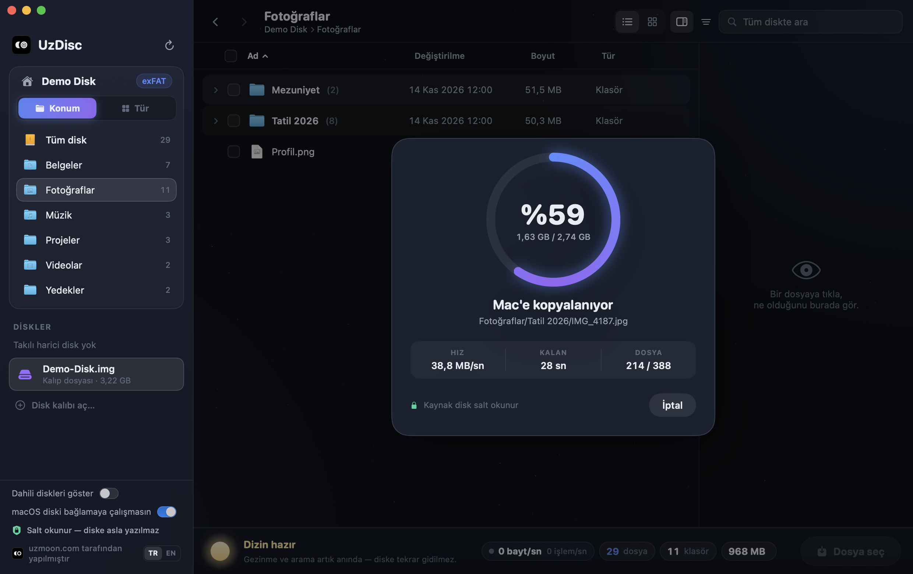</td>
  </tr>
  <tr>
    <td align="center"><sub>Türe göre gez, fotoğrafları küçük resimle gör</sub></td>
    <td align="center"><sub>Mac'e kopyalama — kaynak disk salt okunur</sub></td>
  </tr>
  <tr>
    <td>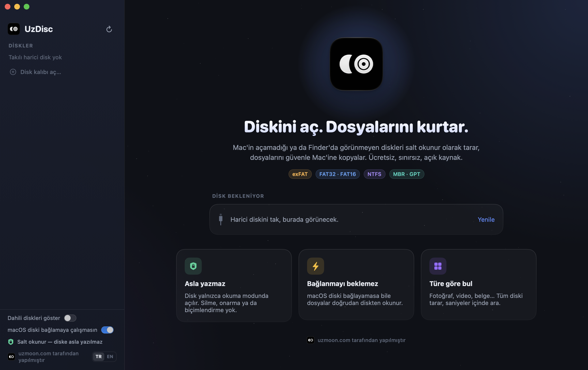</td>
    <td>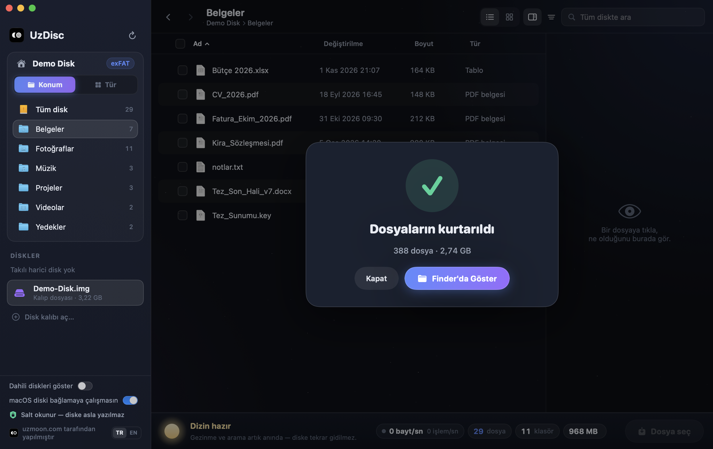</td>
  </tr>
</table>

## Kurulum

1. [Son sürümden](../../releases/latest) `UzDisc-x.y.z.dmg` dosyasını indir.
2. Aç ve **UzDisc**'i **Applications** klasörüne sürükle.
3. İlk açılışta macOS "geliştirici doğrulanamadı" diyebilir (uygulama Apple'a ücretli olarak imzalatılmadı):
   - Uygulamalar'da UzDisc'e **sağ tık → Aç → Aç**, ya da
   - macOS 15+: **Sistem Ayarları → Gizlilik ve Güvenlik → Yine de Aç**, ya da Terminal'de:
     ```sh
     xattr -dr com.apple.quarantine /Applications/UzDisc.app
     ```
4. Harici diskleri okumak için **Tam Disk Erişimi** gerekir:
   **Sistem Ayarları → Gizlilik ve Güvenlik → Tam Disk Erişimi → + → UzDisc**.
   (Bu izinle de UzDisc diske yalnızca okumak için erişir.)

Açılışta bir kez yönetici parolası istenir — ham diske erişim için macOS'un kuralı bu.

## Nasıl çalışır?

```
UzDisc.app (SwiftUI, kullanıcı olarak)
   │  satır tabanlı JSON, kullanıcıya özel FIFO (0600)
   ▼
uzdisc-helper (yönetici)  ──O_RDONLY──▶  /dev/rdiskN
   │  bölüm tablosu (MBR / GPT)  →  exFAT · FAT · NTFS okuyucu
   ▼
Kopyalanan dosyalar senin kullanıcı adına yazılır (chown)
```

- **Kendi dosya sistemi okuyucuları:** exFAT (FAT zinciri + NoFatChain), FAT12/16/32 (uzun dosya adlarıyla), NTFS (parçalı `$MFT`, öznitelik listeleri, seyrek ve **LZNT1 sıkıştırılmış** dosyalar, büyük dizinler).
- **Yardımcı süreç yalnızca** `/dev/(r)diskN` aygıtlarını salt okunur açar; başka yol kabul etmez. FIFO'lar açılır açılmaz silinir.
- Büyük klasörler **akış hâlinde** okunur: 24.000 dosyalı bir klasörde ilk dosyalar anında görünür.
- Diskleri okumak için macOS'un bağlama servisine ihtiyaç duymaz; sistemin disk servisi takılı kalsa bile çalışır.

Desteklenmeyenler: APFS/HFS+ (macOS zaten açar), EFS ile şifrelenmiş ve Windows sistem sıkıştırmalı (WOF) NTFS dosyaları — bunlar açık bir hata mesajıyla atlanır. Silinmiş dosya kurtarma şimdilik yok.

## Komut satırı

Uygulamanın içindeki yardımcı araç tek başına da kullanılabilir:

```sh
H=/Applications/UzDisc.app/Contents/MacOS/uzdisc-helper
$H disks                                   # diskleri listele
sudo $H parts /dev/rdisk5                  # bölümler
sudo $H ls /dev/rdisk5 /Fotograflar        # klasör içeriği
sudo $H cp /dev/rdisk5 /Belgeler ~/Desktop/Kurtarilanlar
```

## İpucu: disk çok yavaşsa

Kenar çubuğunda diskin yanında 🐢 **USB 2.0 · 480 Mb/s** görüyorsan, disk yanlış/eski bir kabloyla bağlı demektir.
USB 3 destekli bir USB-C kablo (örn. diskin kutusundan çıkan) hem **10–20 kat hız** hem de sürücüye yeterli güç sağlar.
Alt çubuktaki canlı hız göstergesi, diskin gerçekten okunup okunmadığını gösterir.

## Kaynaktan derleme

```sh
git clone https://github.com/ahmeterdgn/uzdisc && cd uzdisc
swift test                        # 16 birim testi (gerçek exFAT/FAT/NTFS kalıplarıyla)
./scripts/build-app.sh            # build/UzDisc.app (evrensel)
VERSION=1.0.0 ./scripts/make-dmg.sh
```

Gereksinim: Xcode 15+ / Swift 5.9+, macOS 13+. Test kalıpları `scripts/make-fixtures.sh` ile Docker içinde Linux'un gerçek `mkfs` araçlarıyla üretilir.

---

<a name="english"></a>

## English

<p align="center">
  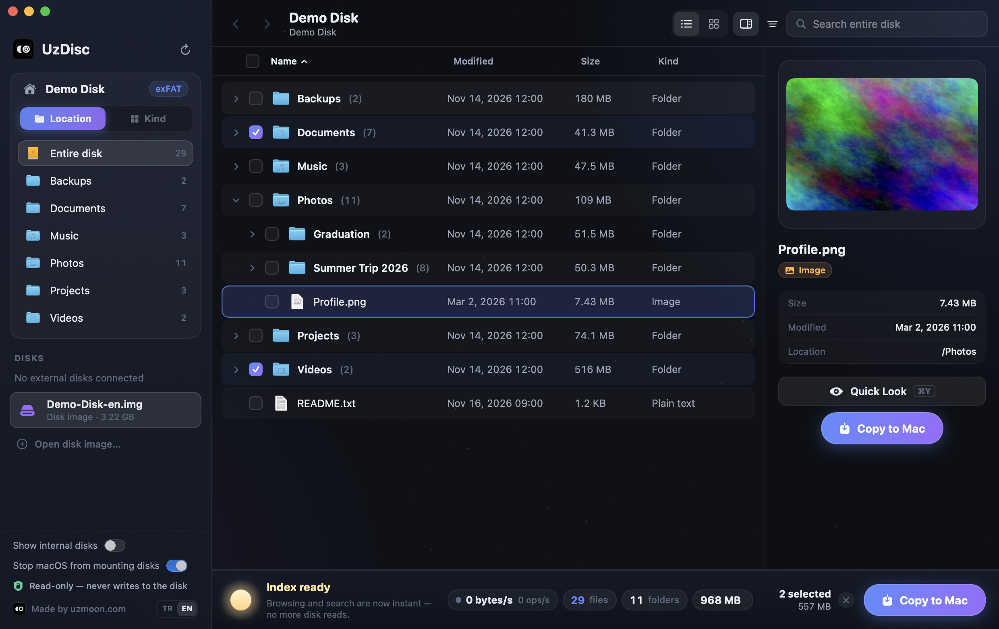
</p>

**UzDisc opens disks your Mac can't — read-only — and safely copies your files to your Mac.** Free, unlimited, open source.

- 🔒 **Never writes.** The disk is opened with `O_RDONLY` only. No deleting, repairing or formatting.
- ⚡ **No mounting needed.** Even if macOS can't mount the disk, the file system is read directly (exFAT, FAT32/16/12, NTFS).
- 🌙 **Reads before macOS does.** While UzDisc is open it can stop macOS from automounting external disks, so the system's disk check doesn't hog a slow connection.
- 🗂 **Browse by location or kind.** The whole disk is indexed once; browsing and **whole-disk search** are instant afterwards.
- 👁 **See what it is.** Thumbnails for photos, videos and PDFs; full Quick Look preview (⌘Y).
- ⚡ **Scan this first.** Prioritize any folder; pause/resume the scan.
- 📈 **Know what's happening.** Live read speed (MB/s · ops/s), stall warnings and slow USB 2.0 cable detection.

<table>
  <tr>
    <td>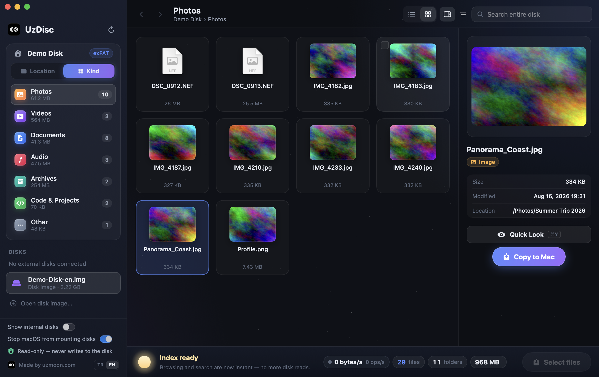</td>
    <td>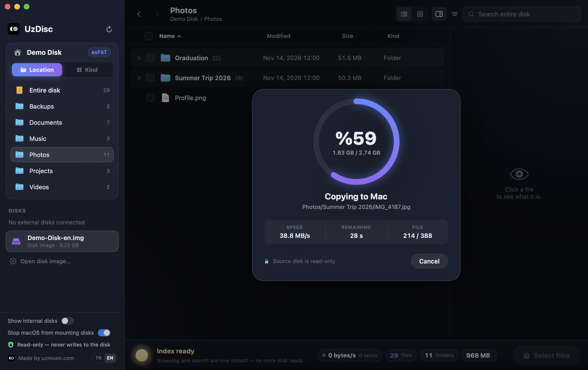</td>
  </tr>
  <tr>
    <td>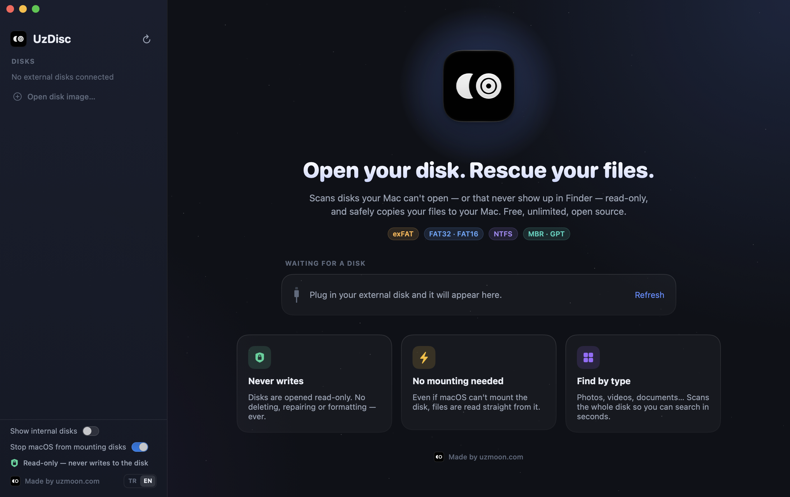</td>
    <td>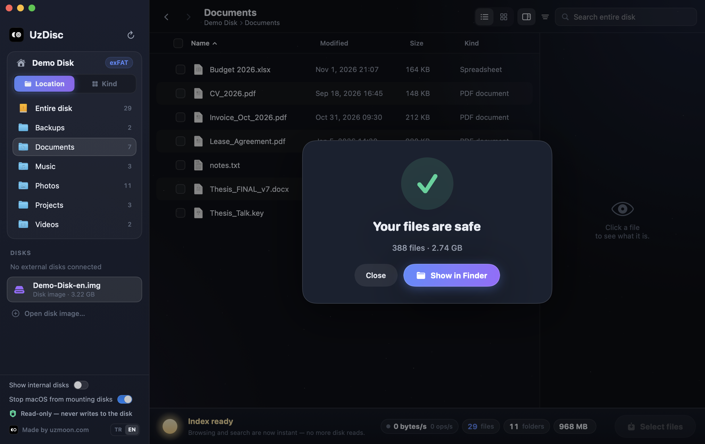</td>
  </tr>
</table>

### Install

1. Download `UzDisc-x.y.z.dmg` from the [latest release](../../releases/latest) and drag **UzDisc** to **Applications**.
2. The app isn't notarized, so on first launch: **right-click → Open → Open** (macOS 15+: *System Settings → Privacy & Security → Open Anyway*), or run
   `xattr -dr com.apple.quarantine /Applications/UzDisc.app`.
3. Grant **Full Disk Access** (*System Settings → Privacy & Security → Full Disk Access → + → UzDisc*). An administrator password is asked once per launch — macOS requires it for raw disk access.

The UI language follows your system (Turkish/English) and can be switched with the **TR | EN** toggle in the sidebar.

### Build from source

```sh
swift test && ./scripts/build-app.sh && VERSION=1.0.0 ./scripts/make-dmg.sh
```

---

<p align="center">
  <a href="https://uzmoon.com">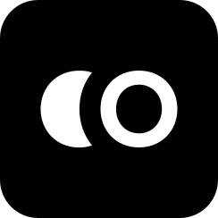</a><br>
  <sub><a href="https://uzmoon.com">uzmoon.com</a> tarafından yapılmıştır · Made by <a href="https://uzmoon.com">uzmoon.com</a></sub><br>
  <sub>MIT Lisansı</sub>
</p>
